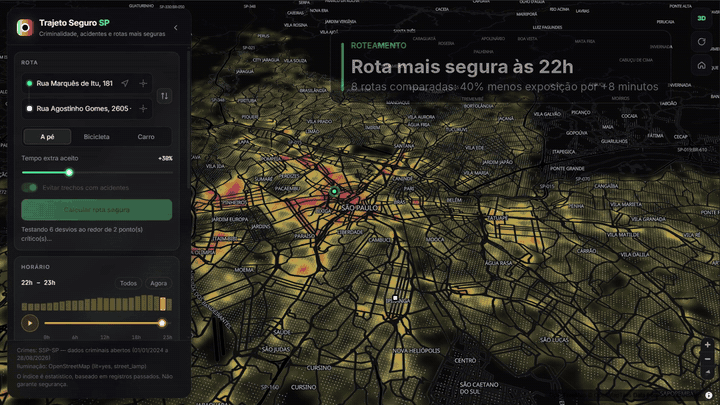

# Trajeto Seguro SP

[](https://github.com/JH-2002/trajeto-seguro-sp/actions/workflows/ci.yml)
[](https://jh-2002.github.io/trajeto-seguro-sp/)
[](https://github.com/JH-2002/trajeto-seguro-sp/actions/workflows/update-data.yml)

**Mapa 3D da criminalidade em São Paulo, com rotas que desviam das áreas de maior risco.**

Os dados vêm de bases públicas: crimes da **SSP-SP**, coletados por web scraping e atualizados todo mês; acidentes do **Infosiga-SP**; e iluminação pública do **GeoSampa**. O app mostra onde e **em que horário** as ocorrências se concentram e sugere o trajeto de menor exposição dentro do tempo extra que você aceita.

🔗 **Demo:** https://jh-2002.github.io/trajeto-seguro-sp/



---

## O que dá para fazer

| | |
|---|---|
| 🔥 **Mapa de calor e colunas 3D** | Concentração de ocorrências em gradiente amarelo → vermelho, com prédios 3D e névoa no horizonte |
| 🕘 **Linha do tempo de 24 h** | Um "play" que anima o calor hora a hora. A rota sugerida muda conforme o horário da viagem |
| 🛡️ **Rota mais segura** | Compara a rota mais rápida com desvios gerados automaticamente e escolhe a de menor exposição dentro do tempo extra aceito |
| ❓ **Por que esta rota?** | Destaca em vermelho os trechos críticos da rota mais rápida que a rota sugerida evita |
| 💡 **Iluminação pública** | À noite, ruas mal iluminadas pesam mais no cálculo (postes do GeoSampa) |
| 🔎 **Inspetor de área** | Clique em qualquer ponto: tipos de crime, horário de pico, tendência anual, acidentes, iluminação e comparação com a média da cidade |
| 🔗 **Link compartilhável** | Origem, destino, modo, horário e filtros vão para a URL. Há também um botão para usar a localização atual |
| ⚡ **Desempenho** | Calor na GPU, nível de detalhe por distância e um modo leve que liga sozinho em máquinas lentas |

## Como funciona

### Coleta de dados

- **SSP-SP (`scripts/scrape-ssp.ts`)**: o portal de consultas é uma aplicação Angular sem API. O scraper lê a página e os **bundles JavaScript** para descobrir a pasta das planilhas `SPDadosCriminais_<ANO>.xlsx`. Depois, valida cada arquivo sem baixar (a SPA responde 200 com HTML para caminhos inexistentes), baixa em streaming com verificação de integridade e guarda ETag/Last-Modified para **baixar só o que mudou**.
- **Processamento (`scripts/prepare-data.ts`)**: as planilhas (centenas de MB) são lidas **linha a linha**. Para cada B.O., o script remove duplicatas, categoriza a natureza do crime e agrega tudo em células de ~110 m por **categoria × hora do dia × mês**. Do mês saem o **peso por recência** (meia-vida de 12 meses) e as janelas de **tendência** (últimos 12 meses vs. 12 anteriores).
- **Iluminação (`scripts/fetch-lighting.ts`)**: descobre a camada de pontos de iluminação no WFS do GeoSampa e a pagina. Se o serviço estiver indisponível, usa as vias `lit=yes` e os postes do OpenStreetMap.
- **Atualização automática**: um workflow do GitHub Actions roda todo dia 5, regenera os JSON e republica o site.

### Rota mais segura

1. O OSRM devolve a rota direta e até 3 alternativas para o modo escolhido (a pé, bicicleta ou carro).
2. O app encontra os **picos de densidade** na rota mais rápida e gera **pontos de desvio** perpendiculares a cada pico, descartando os que caem em áreas igualmente críticas.
3. Cada rota é amostrada a cada 30 m. Em cada amostra, mede-se a densidade de ocorrências num raio de 180 m (kernel biquadrático), ponderada pela gravidade (violento 3, roubo 2, furto 1, outros 0,5) e filtrada pelo **horário** escolhido.
4. **Custo** = exposição a crimes + acidentes (normalizados à mesma escala) + **penalidade de escuridão** à noite.
5. Vence a rota de menor custo cujo tempo não passe do limite definido pelo usuário. Mudar filtros, horário ou tolerância reordena as rotas na hora, sem nova consulta ao servidor.

O **índice de risco (0–100)** compara a densidade média do trajeto com a densidade típica da cidade.

## Rodando localmente

```bash
npm install
npm run dev            # http://localhost:5173 (já vem com dados de demonstração)
npm test               # testes de geometria, risco, rotas, pipeline e scraper
```

Requer Node 20+. Os dados de demonstração são **sintéticos**, e uma faixa amarela no painel avisa quando estão em uso.

### Dados reais

```bash
npm run data:update     # baixa as planilhas da SSP-SP (3 anos) e gera public/data/crimes.json
npm run data:lighting   # iluminação pública (GeoSampa, com OSM como alternativa)
```

Para os acidentes, baixe `dados_infosiga.zip` em <https://infosiga.detran.sp.gov.br/>, coloque o CSV de **sinistros** em `data/raw/` e rode `npm run data -- --raw-dir data/raw`.

Outras opções:

- `npm run data:scrape -- --years 2022-2025` escolhe os anos.
- `npm run data:scrape -- --dry-run` mostra o que foi encontrado, sem baixar.
- `npm run data -- --help` lista as opções de processamento.

## Publicando (GitHub Pages)

1. Suba o projeto para um repositório no GitHub.
2. Em **Settings → Pages**, escolha **Source: GitHub Actions**.
3. A cada push na `main`, o workflow `deploy.yml` faz o build e publica o site em `https://<usuário>.github.io/<repositório>/`.

Para o workflow mensal conseguir fazer commit dos dados, ative **Settings → Actions → General → Workflow permissions → Read and write**.

Os badges e o link no topo deste README assumem o repositório `JH-2002/trajeto-seguro-sp`. Ajuste se usar outro nome.

### Gravando o GIF da demonstração

Grave 20–30 segundos com o [ScreenToGif](https://www.screentogif.com/) (Windows) e salve como `docs/demo.gif`. Uma sequência que funciona bem:

1. Visão geral 3D.
2. Play na linha do tempo, mostrando o calor se movendo pela cidade.
3. Uma rota calculada com os trechos evitados em vermelho.
4. O inspetor de área aberto num ponto.

## Estrutura

```
src/
  main.ts                 estado e ligação entre painel, mapa e dados
  config.ts               URLs, pesos de risco, iluminação, desempenho, cores
  map/mapView.ts          MapLibre (calor, luzes, prédios) + deck.gl (colunas, rotas, trechos evitados)
  data/dataStore.ts       carga e decodificação dos JSON, filtros por hora/categoria/recência, modelo de risco
  data/inspect.ts         estatísticas do inspetor de área
  risk/densityGrid.ts     índice espacial + densidade por kernel
  risk/scoring.ts         exposição, escuridão, índice de risco, picos, trechos evitados
  routing/                interface de roteamento, OSRM, geração de desvios e ranqueamento
  geocoding/photon.ts     busca de endereços
  ui/                     linha do tempo, inspetor, cards de rota, autocompletar, link compartilhável
scripts/
  scrape-ssp.ts           web scraping + download incremental da SSP-SP
  prepare-data.ts         planilhas → public/data/crimes.json (e acidentes)
  fetch-lighting.ts       GeoSampa WFS / OpenStreetMap → public/data/lighting.json
  generate-demo.ts        dados sintéticos
.github/workflows/        CI, deploy no GitHub Pages e atualização mensal dos dados
tests/                    testes automatizados (node:test)
```

## Serviços externos

Todos são gratuitos e sem chave de API, mas são servidores comunitários com política de uso justo. As URLs ficam em `.env` (veja `.env.example`).

| Serviço | Uso | Para produção |
|---|---|---|
| OpenFreeMap | mapa base escuro e altura dos prédios | pode continuar |
| routing.openstreetmap.de (FOSSGIS) | rotas a pé, de bicicleta e de carro | OSRM próprio em Docker |
| Photon (komoot) | busca de endereços | Photon próprio |

## Limitações

- O índice reflete **registros** de ocorrência, não o risco real. Áreas com mais policiamento ou mais movimento tendem a ter mais B.O.s, e há subnotificação. Os números descrevem padrões estatísticos de lugares, não de pessoas ou comunidades.
- Parte dos B.O.s não tem coordenadas (ou estão ocultas por sigilo, como em crimes sexuais), e algumas são aproximadas. Quando o número do endereço falta, várias ocorrências caem no mesmo ponto da via. Em 2024, menos de 1% dos registros estava nesses pontos empilhados.
- B.O.s registrados hoje sobre fatos antigos são mantidos no mapa, mas não contam para definir o período coberto nem a tendência.
- A cobertura de iluminação do OpenStreetMap é parcial. O GeoSampa é a fonte preferida.
- A rota sugerida é uma recomendação estatística. Ela não garante segurança.

## Fontes de dados

- **SSP-SP**: estatísticas criminais abertas (<https://www.ssp.sp.gov.br/estatistica/consultas>)
- **Infosiga-SP / DETRAN-SP**: sinistros de trânsito
- **GeoSampa / Prefeitura de São Paulo**: pontos de iluminação pública
- **© Colaboradores do OpenStreetMap**: mapa base, roteamento e iluminação alternativa (ODbL)
